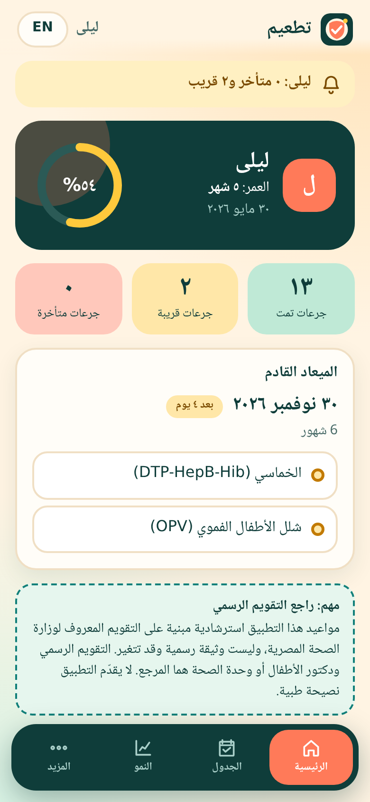
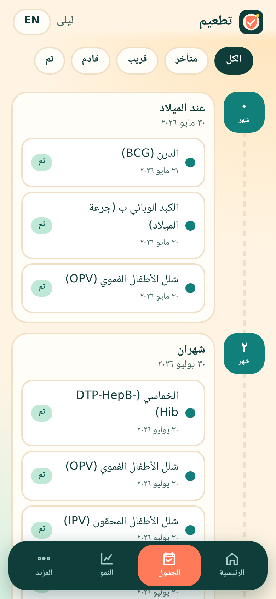
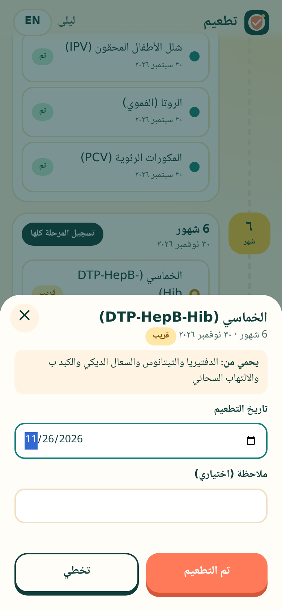
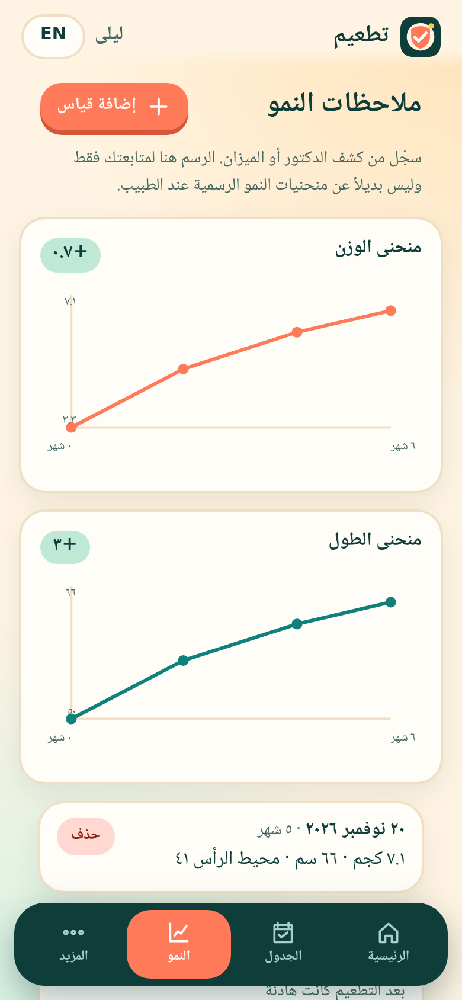
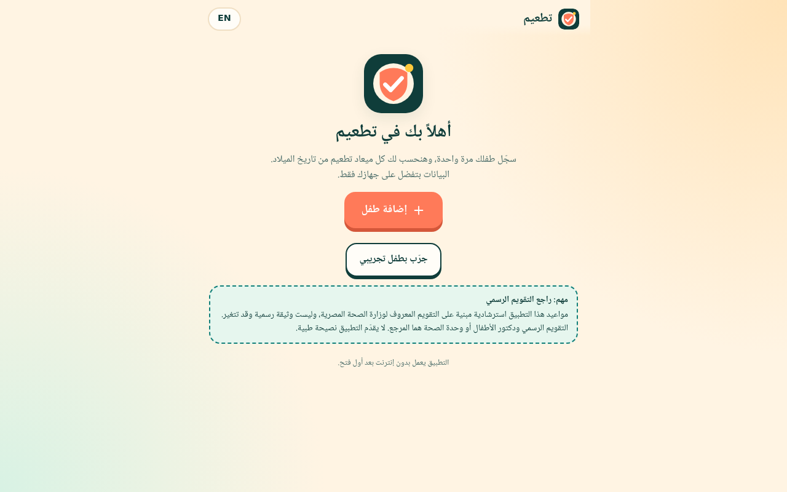

<p align="center"></p>
<h1 align="center">Tateem | تطعيم</h1>
<p align="center"><b>Your child's vaccine schedule, reminders and growth notes. Arabic and English. Free. No account.</b></p>
<p align="center"><a href="https://yousefkhames.github.io/tateem/">Live demo</a> · MIT license · no server, no tracking</p>

<p align="center">




</p>

## Screenshots

Captured from the live site (https://yousefkhames.github.io/tateem/).

<p>
  
  
</p>

## The pitch

Parents in Egypt carry a paper vaccination card and a lot of dates in their heads. Tateem turns the child's birth date into a full, readable timeline: what is done, what is due soon, what is late. Tick doses off, get reminders in your phone calendar, and keep weight and length notes next to the vaccines so they are all in one place at the next clinic visit.

> **Check against the official calendar.** The schedule inside Tateem is **indicative**. It follows the Egyptian national routine immunisation calendar as publicly known, but it is not an official document, it can be out of date, and it has not been reviewed by a doctor. Always confirm dates with the Ministry of Health calendar, your health unit or your paediatrician. Tateem gives no medical advice. You can add your own vaccines (private clinic vaccines, boosters) and skip or mark any dose.

## Features

- **Automatic timeline** from the birth date: birth, 2, 4, 6, 9, 12, 18 months and school entry. Month-end safe (31 Jan + 1 month is 28 Feb) and leap-day safe.
- **Dose status**: done (with date), skipped, overdue, due within 14 days, upcoming. Filter by status. Mark a whole stage in one tap.
- **What each vaccine protects against**, in plain language.
- **Your own vaccines** at any age in months.
- **Reminders that actually work**:
  - Download an **.ics calendar file**. Each pending vaccine date becomes an all-day event with an alert the day before and at 9 AM that day. This works on iPhone, Android and Google Calendar even when the site is closed.
  - Optional **browser notifications** (1, 3 or 7 days ahead). They only fire when the app is open, because a static site cannot push while closed.
- **Growth notes**: weight, length, head circumference with notes, line charts, change since the previous entry. Input is range-checked. The charts are for your own tracking, not WHO percentile curves.
- **Several children**, quick switcher, edit and delete.
- **Backup**: export and import JSON (imports are sanitised, never trusted). Print a vaccination card.
- **Arabic (default, RTL) and English (LTR)**, mobile first, works at 320 px and on desktop, keyboard friendly, reduced-motion aware.
- **Offline** after the first load (service worker).

## Tech

Plain HTML, CSS and JavaScript. No framework, no build step, no dependencies at runtime, no external fonts or requests. Logic lives in `js/core.js` (pure functions, unit tested), UI in `js/app.js`, strings in `js/i18n.js`. Data is stored in `localStorage`.

## Run and test

```bash
python3 -m http.server 8080      # then open http://localhost:8080
node --test tests/core.test.js   # 14 unit tests
npm i && npm run e2e             # 40 real-browser checks (Chrome via puppeteer-core)
```

`?today=YYYY-MM-DD` overrides today's date. It is used by the tests and the screenshots; it does not change saved data.

The unit tests cover date maths, status rules, reminder selection, .ics output, growth validation, import sanitising and translation completeness. The browser test drives the real UI: create a child, mark and skip doses, add vaccines, add growth entries, download the calendar file, import and export, switch language, notifications (with a stubbed permission), reload persistence and overflow at phone width. The same suite was also run against the live GitHub Pages URL.

## Honest limits

- **The schedule is not official.** See the notice above. The data table is `STAGES` and `VACCINES` at the top of `js/core.js` if you want to adjust it.
- **Data is per browser and per device.** There is no sync and no account. Clearing browser data erases it, so export a backup now and then.
- **GitHub Pages is a demo host**, not production hosting.
- **No push reminders while the app is closed.** Use the calendar file for that.
- Growth charts are simple plots, not percentile curves. Not a medical device.

## License

MIT. See [LICENSE](LICENSE).
